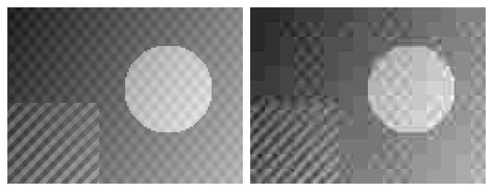

# Studienprojekte – Technische Informatik

Projekte und praktische Arbeiten aus meinem Studium. Die ZIP-Archive enthalten Quellcode und Hinweise zur Einrichtung. Demos sind direkt beim jeweiligen Projekt verlinkt.

## Spieleentwicklung

| Projekt | Beschreibung | Material |
| --- | --- | --- |
| Cube^4 | Unity-Spiel. Lokal liegt ein Windows-Build vor. | Projektübersicht |
| Breakout-Prototyp | Unity-Übung mit C#-Skripten für Schlägersteuerung und Ballverhalten. | [Skripte herunterladen](https://github.com/malshravi-spec/studienprojekte/raw/refs/heads/main/unity-breakout-skripte.zip) |

## Web und mobile Anwendungen

| Projekt | Beschreibung | Material |
| --- | --- | --- |
| Berlin-Stadtführer | Website zu Berliner Sehenswürdigkeiten und Freizeitangeboten mit HTML, CSS und JavaScript. | [Quellcode und lokale Browser-Demo](https://github.com/malshravi-spec/studienprojekte/raw/refs/heads/main/berlin-stadtfuehrer.zip) |
| Android-Taschenrechner | Java-App aus dem Modul Mobile Anwendungsentwicklung. | [Quellcode und Startanleitung](https://github.com/malshravi-spec/studienprojekte/raw/refs/heads/main/android-taschenrechner.zip) |

## Eingebettete und digitale Systeme

| Projekt | Beschreibung | Material |
| --- | --- | --- |
| STM32-Labor | Timer- und GPIO-Übung in C mit STM32CubeIDE. | [Quellcode und STM32CubeIDE-Projekt](https://github.com/malshravi-spec/studienprojekte/raw/refs/heads/main/stm32-systick.zip) |
| Programmierbare Logik | VHDL-Labor mit einem seriell-parallelen Schieberegister. | [SIPO-Quellcode und Simulations-Testbench](https://github.com/malshravi-spec/studienprojekte/raw/refs/heads/main/vhdl-sipo.zip) |

## Software, Daten und Signalverarbeitung

| Projekt | Beschreibung | Material |
| --- | --- | --- |
| DSLP-Chat | Chat-Übung in C aus dem Modul Verteilte Systeme. | Projektübersicht |
| SQL-Datenbankprojekt | Oracle-SQL mit Tabellenschemata und Constraints. | [SQL-Schemata herunterladen](https://github.com/malshravi-spec/studienprojekte/raw/refs/heads/main/oracle-sql-schemata.zip) |
| Kanal- und Quellencodierung | MATLAB-Labor zur blockweisen Bildverarbeitung mit diskreter Kosinustransformation und Quantisierung. | [Quellcode und Demo-Skript](https://github.com/malshravi-spec/studienprojekte/raw/refs/heads/main/matlab-dct.zip) · [Bildvergleich](dct-vergleich.png) |
| Maschinelles Lernen | Jupyter-Übungen zur Klassifikation, unter anderem mit k-nächsten Nachbarn. | Projektübersicht |

### Demo zur Bildcodierung

Links steht das synthetische Testbild, rechts die DCT-Rekonstruktion nach Quantisierung mit Faktor 80. Die Vorschau wurde mit der JavaScript-Umsetzung aus dem MATLAB-Archiv erzeugt.

